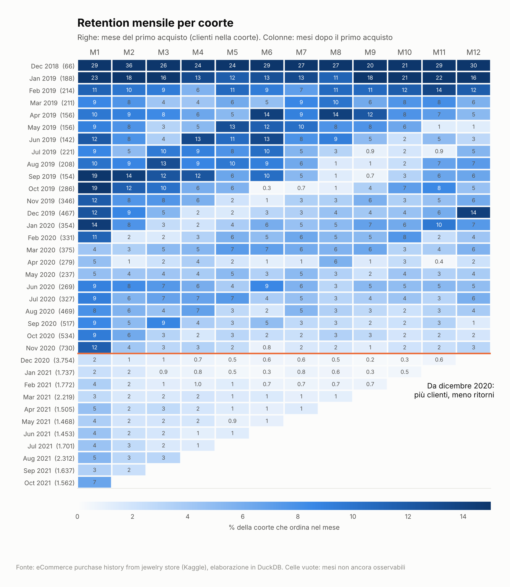
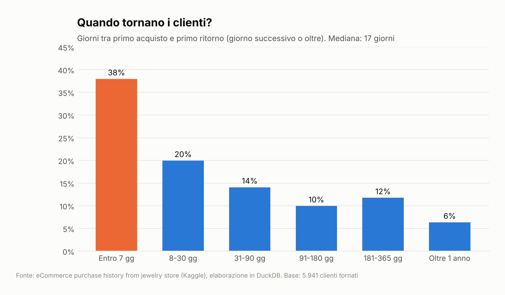
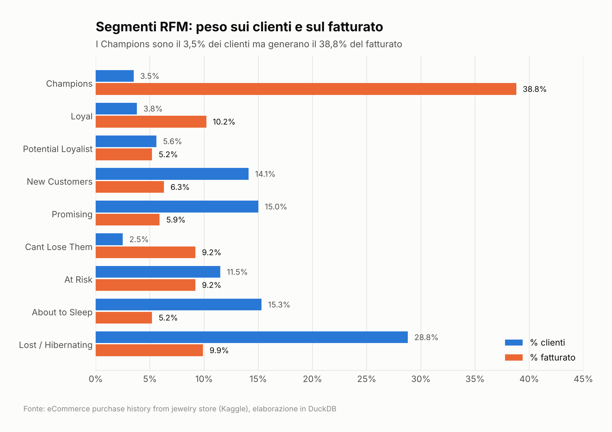
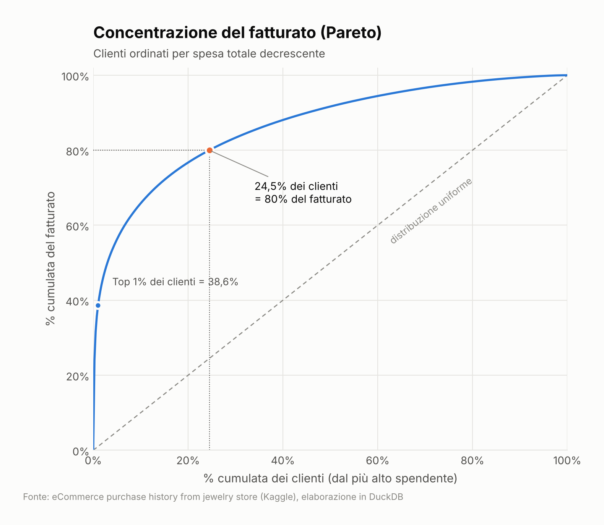
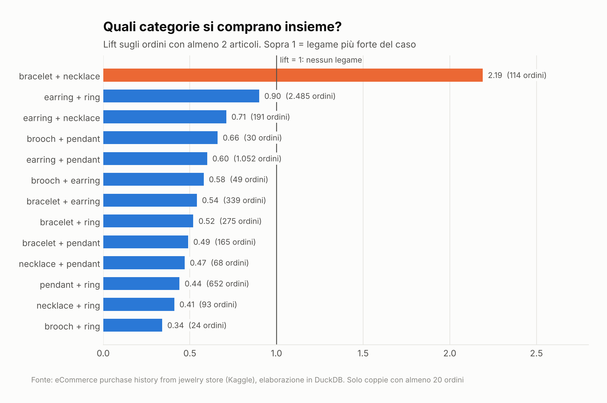

# 💎 Jewelry Customer Retention Analysis


> Analisi end-to-end, interamente in SQL, dello storico acquisti di un e-commerce di gioielleria: quanti clienti tornano, dopo quanto tempo, chi genera il valore e quali prodotti vengono acquistati insieme.

---

## 📑 Indice

1. [Il problema di business](#-il-problema-di-business)
2. [Dataset](#-dataset)
3. [Struttura del repository](#-struttura-del-repository)
4. [Metodologia](#-metodologia)
5. [Visualizzazioni chiave](#-visualizzazioni-chiave)
6. [Risultati e raccomandazioni](#-risultati-e-raccomandazioni)
7. [Difficoltà affrontate](#-difficoltà-affrontate)
8. [Limiti e sviluppi futuri](#-limiti-e-sviluppi-futuri)
9. [Come riprodurre l'analisi](#-come-riprodurre-lanalisi)
10. [Autore](#-autore)

---

## 🎯 Il problema di business

Nella gioielleria l'acquisto è poco frequente e ad alto valore: acquisire un cliente costa molto, e la redditività dipende dalla capacità di farlo tornare. Il progetto risponde a quattro domande che un team CRM si pone ogni giorno:

| # | Domanda | Analisi |
|---|---------|---------|
| 1 | Come si distribuiscono vendite e ordini nel tempo? C'è stagionalità? | EDA |
| 2 | Quanti clienti riacquistano, e dopo quanto tempo? | Retention per coorti, time-to-repurchase |
| 3 | Quali clienti generano il valore e come li segmento? | RFM, analisi di Pareto |
| 4 | Quali prodotti vengono comprati insieme? | Market basket analysis |

L'obiettivo è tradurre i dati in **azioni CRM concrete**: quando contattare un cliente dopo il primo acquisto, quali segmenti proteggere, quali prodotti proporre in cross-selling.

---

## 📦 Dataset

- **Fonte:** [eCommerce purchase history from jewelry store](https://www.kaggle.com/datasets/mkechinov/ecommerce-purchase-history-from-jewelry-store) — Kaggle
- **Periodo:** dicembre 2018 → dicembre 2021
- **Dimensioni:** 95.911 righe (una per prodotto acquistato), 13 colonne, ~13 MB
- **Volumi:** 74.760 ordini · 32.233 clienti · 9.613 prodotti

| Colonna | Descrizione |
|---------|-------------|
| `event_time` | Data e ora dell'acquisto (UTC) |
| `order_id` | Identificativo dell'ordine |
| `product_id` | Identificativo del prodotto |
| `quantity` | Quantità acquistata |
| `category_id` / `category_code` | Categoria (es. `jewelry.earring`, `jewelry.ring`) |
| `brand_id` | Identificativo del brand |
| `price` | Prezzo (USD) |
| `user_id` | Identificativo del cliente |
| `gender` | Genere del prodotto/target |
| `color` / `metal` / `gem` | Attributi del prodotto (colore, metallo, pietra) |

> ⚠️ Il CSV originale **non ha intestazione**: i nomi delle colonne vengono assegnati in fase di importazione. Per licenza e dimensioni, i dati non sono inclusi nel repository (vedi [Come riprodurre l'analisi](#-come-riprodurre-lanalisi)).

---

## 🗂 Struttura del repository

```
jewelry-customer-retention-analysis/
│
├── data/                          ← escluso da GitHub
│   ├── raw/
│   │   └── jewelry_raw_data.csv   ← CSV originale, mai modificato
│   └── processed/
│       └── orders_clean.parquet   ← generato da 01_data_quality.sql
│
├── sql/
│   ├── 01_data_quality.sql        ← importazione e pulizia
│   ├── 02_eda.sql                 ← trend, stagionalità, prodotti
│   ├── 03_retention.sql           ← coorti, tempo al riacquisto
│   ├── 04_segmentation.sql        ← RFM, Pareto
│   └── 05_basket.sql              ← prodotti acquistati insieme
│
├── results/                       ← output delle query in CSV
├── reports/                       ← grafici usati in questo README
│
└── README.md
```

**Perché solo SQL e DuckDB?** DuckDB è un database analitico che gira in locale senza server, legge CSV e Parquet direttamente e supporta SQL moderno (window function, `QUALIFY`, `GROUP BY ALL`). Permette di svolgere l'intera pipeline con lo stesso linguaggio usato nei data warehouse aziendali, senza dipendenze da installare.

---

## 🔬 Metodologia

### 1. Data quality — `01_data_quality.sql`

Controlli eseguiti prima di qualsiasi analisi:

- **Righe malformate:** 5.352 righe hanno 11 campi anziché 13 → importazione con `null_padding` e verifica dell'allineamento delle colonne
- **Clienti mancanti:** 5.352 righe senza `user_id` → escluse dalle analisi sui clienti (retention, RFM), mantenute per i volumi di vendita
- **Categorie sporche:** 9.933 righe senza `category_code` e 4.392 con un valore numerico al posto della categoria → `<!-- TODO: descrivi la scelta, es. ricostruite da category_id / etichettate 'unknown' -->`
- **Duplicati:** verifica di righe esattamente identiche
- **Tipi e formati:** conversione di `event_time` in timestamp, controllo di prezzi nulli o anomali
- **Output:** tabella pulita salvata in `orders_clean.parquet`

### 2. Analisi esplorativa — `02_eda.sql`

Andamento mensile di fatturato, ordini e clienti attivi; stagionalità (mese, giorno della settimana); valore medio ordine (AOV); categorie, metalli e pietre più venduti.

### 3. Retention — `03_retention.sql`

- **Cohort analysis:** ogni cliente viene assegnato alla coorte del mese del primo acquisto; si misura la quota di clienti che torna nei mesi successivi
- **Repeat purchase rate:** % di clienti con almeno due ordini distinti
- **Time-to-repurchase:** giorni tra primo e secondo ordine (mediana e distribuzione), calcolati con `LAG()` sulla sequenza ordini del cliente

> *Perché le coorti?* Una retention media unica nasconde l'effetto del tempo e delle stagioni: le coorti mostrano se i clienti acquisiti a dicembre (regali) si comportano diversamente da quelli acquisiti nel resto dell'anno.

### 4. Segmentazione — `04_segmentation.sql`

- **RFM** (Recency, Frequency, Monetary): punteggi da 1 a 5 per ogni dimensione con `NTILE(5)`, poi aggregati in segmenti di business (Champions, Loyal, At Risk, Lost…)
- **Pareto:** quota cumulata di fatturato per percentile di clienti, per verificare la regola 80/20

> *Perché RFM e non clustering?* RFM è interpretabile, facilmente spiegabile al business e direttamente attivabile su una piattaforma CRM. In un contesto a bassa frequenza d'acquisto offre segmenti stabili senza la complessità di un modello di machine learning.

### 5. Market basket — `05_basket.sql`

Self-join sulla tabella ordini per contare le coppie di categorie acquistate nello stesso ordine; calcolo di **support**, **confidence** e **lift** per distinguere le associazioni reali da quelle dovute alla sola popolarità dei prodotti.

---

## 📊 Visualizzazioni chiave

> Sostituisci i nomi dei file con quelli presenti in `reports/figures/`.

### Andamento mensile del fatturato

*`<!-- TODO: messaggio principale, es. picchi a dicembre e febbraio -->`*

### Matrice di retention per coorte

*`<!-- TODO: es. solo il X% dei clienti torna entro 3 mesi -->`*

### Distribuzione del tempo al riacquisto

*`<!-- TODO: es. la mediana è di N giorni -->`*

### Segmenti RFM

*`<!-- TODO: es. i Champions sono il X% dei clienti ma il Y% del fatturato -->`*

### Curva di Pareto

*`<!-- TODO: es. il 20% dei clienti genera il X% del fatturato -->`*

### Categorie


---

## 💡 Risultati e raccomandazioni

### Risultati principali

| Area | Risultato |
|------|-----------|
| Vendite | `<!-- TODO -->` |
| Stagionalità | `<!-- TODO -->` |
| Retention | `<!-- TODO: repeat purchase rate -->` |
| Tempo al riacquisto | `<!-- TODO: mediana in giorni -->` |
| Concentrazione del valore | `<!-- TODO: risultato Pareto -->` |
| Cross-selling | `<!-- TODO: coppia di categorie con lift più alto -->` |

### Raccomandazioni CRM

1. **Second purchase journey** — attivare un flusso automatico calibrato sul tempo mediano di riacquisto, con il primo contatto `<!-- TODO -->` giorni dopo il primo ordine
2. **Protezione dei clienti di valore** — programma dedicato ai segmenti Champions e Loyal (accesso anticipato, servizi esclusivi) invece di sconti generalizzati
3. **Win-back** — campagna mirata ai clienti At Risk prima che diventino Lost
4. **Cross-selling** — raccomandazioni post-acquisto basate sulle coppie di categorie con lift più alto
5. **Calendario commerciale** — concentrare budget e comunicazioni sui periodi di picco individuati

---

## 🧗 Difficoltà affrontate

- **CSV senza header e con righe di lunghezza diversa** — il rilevamento automatico di DuckDB falliva: ho definito esplicitamente schema e opzioni di importazione e verificato l'allineamento delle colonne
- **Qualità delle categorie** — valori mancanti e valori numerici nel campo testuale, gestiti `<!-- TODO -->`
- **Granularità** — il dataset è a livello di riga prodotto e non di ordine: tutte le metriche cliente (frequenza, AOV, retention) vengono calcolate dopo l'aggregazione per `order_id`, per evitare di contare più volte lo stesso ordine
- **Scelta del dataset** — scartati un dataset da 9 GB (ingestibile in locale) e uno meno legato al business, a favore di un caso realistico di retail
- `<!-- TODO: aggiungi altre difficoltà incontrate -->`

---

## 🚧 Limiti e sviluppi futuri

**Limiti**
- Dataset anonimizzato: nessun dato demografico, sul canale di acquisizione o sulle campagne
- Le righe senza `user_id` sono escluse dalle analisi cliente
- Prezzi in valuta non dichiarata esplicitamente; nessuna informazione su margini e resi

**Sviluppi futuri**
- Stima del Customer Lifetime Value (CLV) per segmento
- Modello predittivo di churn o di probabilità di riacquisto
- Dashboard interattiva (Power BI) collegata ai risultati in `results/`

---

## ▶️ Come riprodurre l'analisi

### Requisiti
- [DuckDB CLI](https://duckdb.org/docs/installation/) (v1.x)
- Su Mac: `brew install duckdb`

### Passaggi

```bash
# 1. Clona il repository
git clone https://github.com/<tuo-username>/jewelry-customer-retention-analysis.git
cd jewelry-customer-retention-analysis

# 2. Scarica il dataset da Kaggle e salvalo come:
#    data/raw/jewelry_raw_data.csv
mkdir -p data/raw data/processed results

# 3. Esegui gli script in ordine
duckdb jewelry.duckdb < sql/01_data_quality.sql
duckdb jewelry.duckdb < sql/02_eda.sql
duckdb jewelry.duckdb < sql/03_retention.sql
duckdb jewelry.duckdb < sql/04_segmentation.sql
duckdb jewelry.duckdb < sql/05_basket.sql
```

I risultati vengono esportati in `results/`; il database `jewelry.duckdb` viene creato automaticamente al primo avvio.

---

## 👤 Autore

**Riccardo Cuccu** — CRM & Marketing Automation Specialist

[](https://www.linkedin.com/in/rcuccu)
[](https://github.com/ric98CC)

*Dati: Kaggle — "eCommerce purchase history from jewelry store". Progetto a scopo didattico e di portfolio.*
